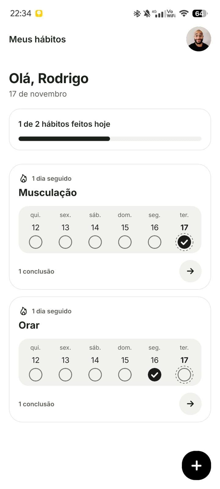
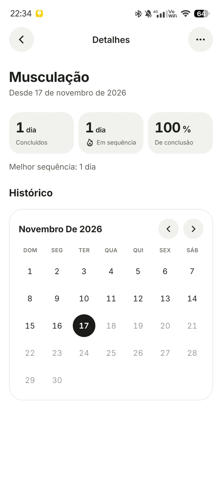
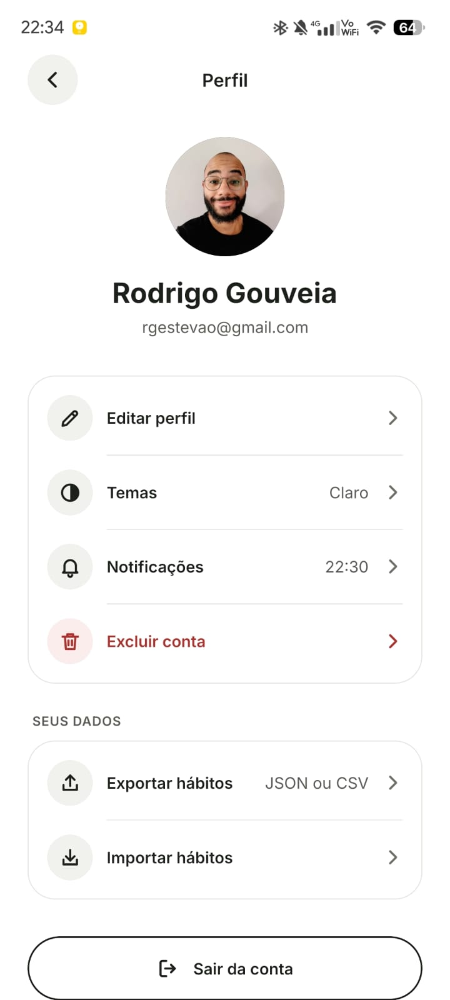

# Ritmo

Um app de hábitos para manter o seu ritmo, um dia de cada vez.

O Ritmo tem uma interface minimalista em traço preto e branco, com o Pingo, o mascote do app, como companhia. Crie um hábito só com o nome, marque cada dia com um toque e acompanhe a sequência, o total e a sua taxa de conclusão. Sua conta e seus hábitos ficam salvos na nuvem (Supabase), então nada se perde ao trocar de celular.

## Telas

<p align="center">
  
  &nbsp;
  
  &nbsp;
  
  &nbsp;
  
</p>

<p align="center"><sub>Cadastro · Home · Detalhes do hábito · Perfil</sub></p>

## Funcionalidades

- **Onboarding e conta:** três telas de boas-vindas na primeira abertura, cadastro e login por e-mail ou com Google, confirmação de e-mail e recuperação de senha.
- **Registro em um toque:** marque ou desmarque os últimos seis dias direto na Home, com um check desenhado, um pequeno "pop" e confetes ao concluir o dia de hoje ou bater um recorde.
- **Progresso do dia:** a Home mostra quantos hábitos você já fez hoje.
- **Detalhes do hábito:** dias concluídos, sequência atual, porcentagem de conclusão, melhor sequência e um calendário para corrigir qualquer dia do histórico.
- **Perfil:** foto do Google, editar nome, excluir conta (com todos os dados) e sair.
- **Tema claro e escuro:** escolha Claro, Escuro ou Sistema; a preferência fica salva no celular.
- **Lembrete diário:** uma notificação local por dia, no horário que você escolher.
- **Exportar e importar:** leve seus hábitos em JSON (backup completo) ou CSV (planilhas) e traga de volta; hábitos com o mesmo nome são combinados, sem duplicar dias.

Cada hábito aceita uma conclusão por dia e datas futuras não podem ser marcadas. A sequência continua ativa enquanto hoje ainda está em andamento, desde que ontem tenha sido concluído.

## Tecnologias

| Área          | Tecnologia                                          |
| ------------- | --------------------------------------------------- |
| Aplicativo    | React Native 0.86 e Expo SDK 57 (development build) |
| Linguagem     | TypeScript                                          |
| Navegação     | Expo Router, com rotas protegidas por sessão        |
| Backend       | Supabase: Auth e Postgres com Row Level Security    |
| Login social  | Google Sign-In nativo                               |
| Ilustrações   | react-native-svg (logo, Pingo e cenas em traço)     |
| Notificações  | expo-notifications (lembrete local)                 |
| Build e envio | EAS Build (APK) e EAS Update (atualizações pelo ar) |
| Testes        | Jest e React Native Testing Library                 |

## Configuração

O passo a passo completo do Supabase, do login com Google e do EAS está em [supabase/README.md](supabase/README.md). Em resumo:

1. Crie um projeto no Supabase e rode as migrações de `supabase/migrations/`.
2. Copie `.env.example` para `.env` e preencha a URL e a chave pública do Supabase e o Client ID web do Google.
3. Configure o login com Google (clientes Web e Android no Google Cloud).

## Executar

O login com Google usa código nativo, por isso o app **não roda no Expo Go**: é preciso um development build.

```sh
npm ci
npx eas-cli@latest build --profile development --platform android
npm start
```

Instale o APK gerado no celular e abra o app com o celular na mesma rede do computador.

### Usar sem computador

O perfil `preview` gera um APK com o código embutido, que funciona em qualquer rede:

```sh
npm run build:preview    # novo APK, quando mudar algo nativo
npm run update:preview   # publica mudanças de JavaScript no APK instalado
```

## Comandos de desenvolvimento

| Comando                  | Descrição                                       |
| ------------------------ | ----------------------------------------------- |
| `npm start`              | Inicia o Metro para o development build         |
| `npm run build:preview`  | Gera o APK standalone no EAS                    |
| `npm run update:preview` | Publica uma atualização pelo ar (canal preview) |
| `npm run typecheck`      | Verifica os tipos TypeScript                    |
| `npm run lint`           | Verifica o código com ESLint                    |
| `npm test`               | Executa os testes                               |
| `npm run format:check`   | Verifica a formatação                           |
| `npm run format`         | Aplica a formatação                             |

## Organização do código

```text
app/                         Rotas (onboarding, login, área logada e perfil)
src/
  design-system/             Tokens, tema claro/escuro e componentes
  features/
    auth/                    Conta, login com Google e telas de acesso
    habits/                  Home, detalhes, calendário, métricas,
                             repositório Supabase e importar/exportar
    onboarding/              Onboarding e as ilustrações do Pingo
    profile/                 Perfil, editar, temas e excluir conta
    reminders/               Lembrete diário
  shared/                    Datas locais e cliente Supabase
supabase/                    Migrações SQL e guia de configuração
__tests__/                   Testes automatizados
```

As métricas são derivadas do histórico de conclusões. Cada conclusão usa uma data local no formato `YYYY-MM-DD`, e o banco impede registros duplicados para o mesmo hábito e dia.
